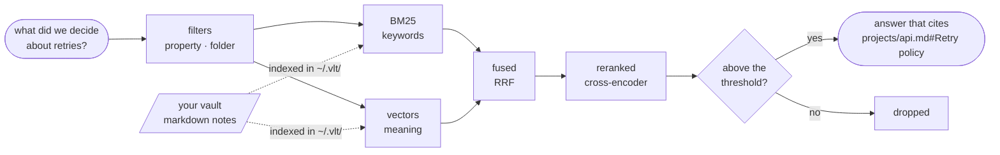

# vlt

> **Semantic search over your Obsidian vault, for your AI agent and for you.**

vlt turns a vault (a folder of markdown notes) into a knowledge base your AI agent can search. It indexes your notes locally and serves them through **MCP for agents** and the **`vlt` CLI for humans**.

Everything runs on your machine: no daemon, no cloud, no API keys.

## What it does

- **Answers from your notes.** Ask your agent "what do I know about X?" and it searches your vault, reads what it needs and cites the notes it used.
- **Enriches your notes.** Ask it to "process the note X" and it proposes properties, links to and from related notes, and fixes for broken links. It applies only the ones you pick.
- **Drafts new notes** that follow your vault's conventions, and writes them once you approve.
- **Audits the vault**: inconsistent properties, broken links, orphan notes.
- **Moves, renames and deletes notes**, rewriting the links a move would break. Deleted notes go to `.trash/` in the vault.

## Why vlt

Your notes hold what no model knows: your projects, your past decisions, your conventions. But an agent can't use them well: it doesn't know they exist, grep won't match "how do we handle retries?" to a note titled *Backoff policy*, and notes drift as they grow.

- **Finds by meaning, not just words**: keyword and semantic search combined, then reranked by relevance.
- **"Nothing relevant" is an answer**: weak matches are dropped instead of returning random hits.
- **Filters**: by property (`status=in_progress`, `tags=rust`, `date>=2026-01-01`) and by folder.
- **You stay in control**: the agent changes your notes only when you approve, and never overwrites or erases one.
- **Local and private**: models run on your CPU and work offline after the first download.
- **No maintenance**: the index keeps itself up to date.

## How it works



A search combines keywords and meaning, reranks the candidates by relevance and keeps only the ones that clear a threshold.

vlt indexes the sections of every note and keeps that index in `~/.vlt/`, together with its config and models. Each call picks up the notes you added, changed or deleted, so you never reindex by hand.

Your agent talks to vlt through MCP; a Skill installed alongside teaches it when to search your notes and how to propose changes. Your vault stays as it is: vlt adds nothing to it except a `.trash/` folder, and the `vlt` CLI never writes to it.

## Install

Requirements: macOS or Linux (x86_64 or aarch64), about 1.5 GB of disk for the models, and optionally an MCP agent: Claude Code, opencode or Codex.

```bash
curl -fsSL https://raw.githubusercontent.com/andresdigiovanni/vlt/main/install.sh | bash
```

The script installs the binary to `~/.local/bin/vlt` (make sure it is on your `PATH`) and runs `vlt install`, which:

1. asks for the path of your vault,
2. downloads the models,
3. connects vlt to the agents you pick,
4. writes `~/.vlt/config.toml`,
5. indexes the vault.

Restart your agent session afterwards. If the script can't ask (in CI, for example), run `vlt install` yourself.

Non-interactive setup:

```bash
vlt install --vault ~/notes --target claude --yes   # --target claude|opencode|codex, repeatable; --all for every agent
```

To register vlt with another MCP client by hand, the server command is `vlt mcp` (stdio).

To install a specific version, append `-s -- --version vX.Y.Z` to `bash` in the install command.

### Upgrade

Run the install script again. It replaces the binary and refreshes the setup of your agents; your config, index and models are kept.

### Uninstall

```bash
vlt uninstall
rm ~/.local/bin/vlt
```

`vlt uninstall` disconnects vlt from every agent and asks whether to delete `~/.vlt/`. It never touches your vault.

## Usage

### With your agent

Just ask:

```text
What do I know about SQLite concurrency?
Which of my projects are in progress?
Process the note projects/vlt_design.md
Write up what we decided today as a new note
Audit the projects folder
```

When the agent proposes changes, it gives you a numbered list; reply with the ones to apply ("apply 1, 3").

### From the terminal

```bash
vlt search "retry policy"
vlt search "retry policy" --where tags=backend --path-prefix projects/
vlt get projects/api.md
vlt properties
vlt audit
```

`vlt --help` lists every command; add `--json` for machine-readable output.

## Configuration

`~/.vlt/config.toml`, written by `vlt install`. The keys you are most likely to change:

```toml
vault = "/path/to/vault"
exclude = ["templates/**"]   # paths not indexed

[models]
embedding = "Qwen/Qwen3-Embedding-0.6B"
reranker  = "mixedbread-ai/mxbai-rerank-base-v1"

[search]
limit = 5          # results returned by default
min_score = 0.02   # relevance threshold
```

After changing `vault` or a model, run `vlt reindex` to rebuild the index.

### Models

Any Hugging Face embedding model or cross-encoder reranker based on BERT, XLM-RoBERTa, Qwen3 (embedding) or DeBERTa-v2 (reranker) works. The defaults favour quality and need about 2.3 GB of memory; for a lighter, faster setup on English notes:

```toml
[models]
embedding = "BAAI/bge-small-en-v1.5"
reranker  = "cross-encoder/ms-marco-MiniLM-L-6-v2"
```

Models are downloaded once and pinned to that version.

## Development

Requires Rust 1.85+. `make help` lists the tasks (`make check` before merging); see [`AGENTS.md`](AGENTS.md) and [`CHANGELOG.md`](CHANGELOG.md).
